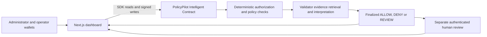

# PolicyPilot

**Every autonomous decision needs a rulebook.**

PolicyPilot evaluates procurement requests from authorized agent operator wallets. Businesses publish immutable versions of their policies. GenLayer validators assess requests against the pinned policy and public vendor evidence. The contract records the resulting policy verdict and any later administrator decision. Verdicts have no payment or execution side effects.

## Live App

[Open PolicyPilot](https://policypilot-phi.vercel.app)

## Run locally

Install Node.js 24 and Python 3.12 or newer. Run:

```sh
npm ci
npm run dev
```

Open [PolicyPilot locally](http://localhost:3000). Without a configured contract, pages and validation remain available and writes are disabled.

Copy `.env.example` to `.env.local` after manual deployment. Set `NEXT_PUBLIC_GENLAYER_NETWORK=studionet` and `NEXT_PUBLIC_GENLAYER_CONTRACT_ADDRESS` to the deployed address. Restart the dev server or rebuild because Next.js embeds public environment values. Use MetaMask with the GenLayer Snap supported by the pinned SDK and distinct administrator and operator wallets.

## Deployed contract

PolicyPilot is deployed on GenLayer Studionet at `0x0a30EB7682cc39Fdc1f94fF2C571039b28EC435A`. [Open the contract in Studio Explorer](https://explorer-studio.genlayer.com/address/0x0a30EB7682cc39Fdc1f94fF2C571039b28EC435A).

Run `npm run test:integration` with the address in `.env.local` to check the deployed ABI, source, and finalized read methods.

## Architecture



Authorization, scoped categories, active policy identity, currency, amounts, required inputs, and declared prohibitions are deterministic. Over-limit requests cannot receive ALLOW. GenLayer's comparative Equivalence Principle weighs independently produced findings about applicable clauses, evidence, and reasons. The official SDK reads the finalized contract snapshot.

- [Architecture](docs/ARCHITECTURE.md) and [policy semantics](docs/POLICY_ENGINE.md)
- [Contract interface](docs/CONTRACT_INTERFACE.md) and [security model](docs/SECURITY.md)
- [Testing and Studionet checklist](docs/TESTING.md)
- [Manual Studio deployment](docs/DEPLOYMENT.md) and [Builder demo](docs/BUILDER_SUBMISSION.md)

## Demo

Use NovaWorks AI's $100 approval threshold and prohibit the `gambling` and `personal` categories. A $29 GitHub Team request for developer collaboration may receive ALLOW when the cited source supports it. A declared gambling request receives DENY under the structured prohibition. A $250 contextual API purchase receives REVIEW if evidence supports it, with any evidence issues recorded separately. An established prohibition can still result in DENY. See the [demo guide](docs/BUILDER_SUBMISSION.md) for fields and wallet roles.

## Evidence, limitations, and roadmap

Evidence is restricted to [GitHub pricing](https://github.com/pricing), [OpenAI API pricing](https://developers.openai.com/api/docs/pricing), and [Claude pricing](https://claude.com/pricing). Sources are live and may change or be unavailable to validators. The audit captures the source URL and any accepted excerpt. Use public test data only. Agent registration authorizes a wallet. Consensus does not establish business identity, verify all facts, or execute payments.

After manual deployment, verify the contract schema, wallet handoff, actual retrieval and model consensus, and finalized state after refresh. Future work can add receipt indexing, wider source coverage with verified redirect controls, and expiring authorization for a separately designed executor.

## Checks

```sh
npm run typecheck
npm run lint
npm test
npm run test:browser
npm run build
```

Browser tests use Edge by default. Set `POLICYPILOT_BROWSER=chrome` for Chrome. See the test guide for official GenLayer tools and live verification.
